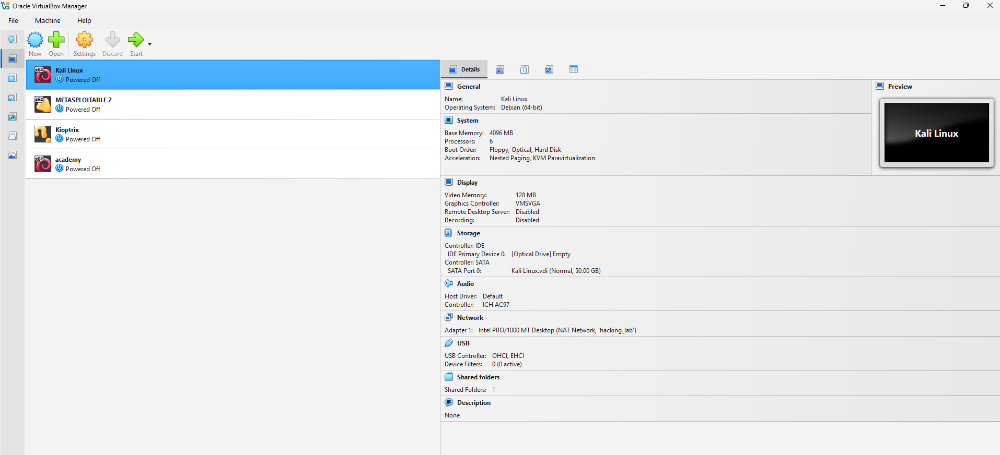
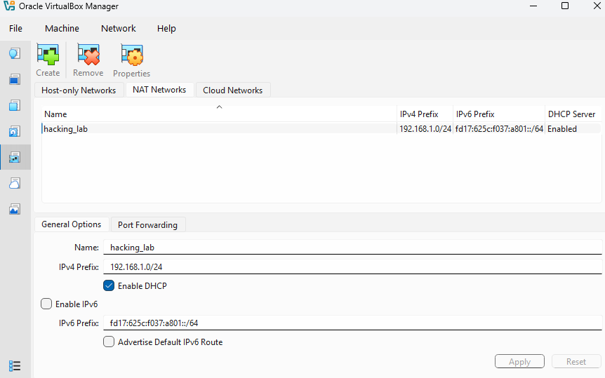
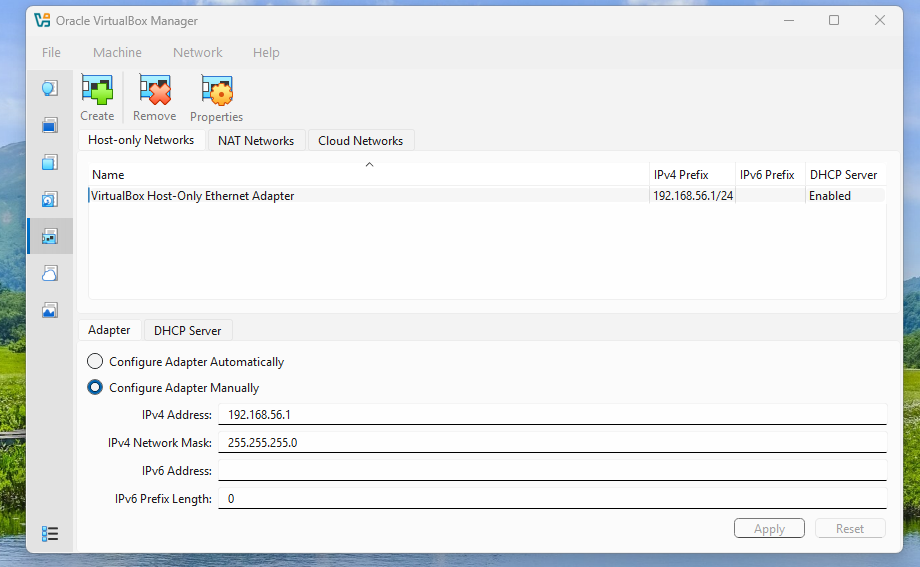

# Kali Linux Lab Setup

## 1. Project Overview

This repository documents the setup and initial configuration of a Kali Linux virtual machine using Oracle VirtualBox as part of my cybersecurity internship learning activities.

The project covers virtual machine configuration, system resource allocation, virtual networking settings, the Kali Linux desktop environment, and basic network connectivity verification.

## 2. Objectives

- Set up Kali Linux in Oracle VirtualBox.
- Review virtual machine system settings.
- Understand NAT Network and Host-Only Network configurations.
- Explore the Kali Linux desktop environment.
- Verify basic network connectivity.
- Document the lab setup using screenshots.

## 3. Tools and Technologies

| Tool | Purpose |
|---|---|
| Kali Linux | Cybersecurity learning and testing environment |
| Oracle VirtualBox | Virtual machine management |
| NAT Network | Virtual networking |
| Host-Only Network | Host-to-VM and isolated lab networking |
| ICMP Ping | Network connectivity testing |

## 4. Virtual Machine Configuration

The following settings were visible in the VirtualBox configuration:

| Setting | Value |
|---|---|
| Virtual Machine | Kali Linux |
| Operating System Type | Debian (64-bit) |
| Base Memory | 4096 MB |
| Video Memory | 128 MB |
| Graphics Controller | VMSVGA |
| Virtual Disk | Kali Linux.vdi |
| Virtual Disk Capacity | 50 GB |

### Screenshot: Virtual Machine Overview



## 5. System Configuration

The Kali Linux virtual machine's system settings were reviewed.

- Base Memory: 4096 MB
- Chipset: PIIX3
- Pointing Device: USB Tablet
- I/O APIC: Enabled
- Hardware Clock in UTC: Enabled
- UEFI: Disabled in the displayed settings

### Screenshot: System Settings



## 6. NAT Network Configuration

A NAT Network named `hacking_lab` was visible in VirtualBox.

| Setting | Value |
|---|---|
| Network Name | hacking_lab |
| IPv4 Network Prefix | 192.168.1.0/24 |
| DHCP Server | Enabled |

The NAT Network can provide network connectivity to virtual machines attached to it, depending on their adapter configuration and the host's network connectivity.

### Screenshot: NAT Network



## 7. Host-Only Network Configuration

The Host-Only Network settings showed the following configuration:

| Setting | Value |
|---|---|
| Adapter | VirtualBox Host-Only Ethernet Adapter |
| IPv4 Address | 192.168.56.1 |
| Network Mask | 255.255.255.0 |
| DHCP Server | Enabled |

A Host-Only Network can allow communication between the host system and virtual machines attached to that network.

### Screenshot: Host-Only Network


## 8. Kali Linux Desktop Environment

Kali Linux was started successfully in Oracle VirtualBox.

The desktop environment provides access to cybersecurity tools for networking, reconnaissance, vulnerability assessment, digital forensics, and other security-related activities.

These tools should be used only in authorized environments.

### Screenshot: Kali Linux Desktop


## 9. Network Connectivity Verification

The following command was executed in the Kali Linux terminal:

```bash
ping -c 4 8.8.8.8
```

### Test Results

| Metric | Result |
|---|---:|
| Packets Transmitted | 4 |
| Packets Received | 4 |
| Packet Loss | 0% |
| Minimum Round-Trip Time | 33.858 ms |
| Average Round-Trip Time | 37.698 ms |
| Maximum Round-Trip Time | 41.449 ms |

### Analysis

All four ICMP requests received replies, with zero packet loss during the test.

This confirms IP-level connectivity to the tested destination at the time of testing. It does not independently verify DNS resolution or connectivity between lab virtual machines.

### Screenshot: Ping Test


## 10. Results

The available screenshots demonstrate that:

- The Kali Linux virtual machine was configured in Oracle VirtualBox.
- The VM system settings were reviewed.
- NAT Network and Host-Only Network settings were inspected.
- Kali Linux started successfully.
- The basic connectivity test to `8.8.8.8` succeeded.

## 11. Security Considerations

- Perform security testing only on systems you own or have permission to test.
- Keep vulnerable lab machines isolated from public networks.
- Review virtual network adapter settings before security testing.
- Do not publish passwords, tokens, or other sensitive information.

## 12. Conclusion

This project documents the initial Kali Linux lab setup using Oracle VirtualBox. The configuration screenshots and connectivity test provide a foundation for future cybersecurity and networking exercises.

Further testing and additional evidence can be added as the lab develops.

## 13. Author

**Name:** Md. Ektearul Haque

**Organization:** Networkwalks

**Program:** Cybersecurity Internship

**Focus Areas:** Cybersecurity, Networking, and Penetration Testing

---
